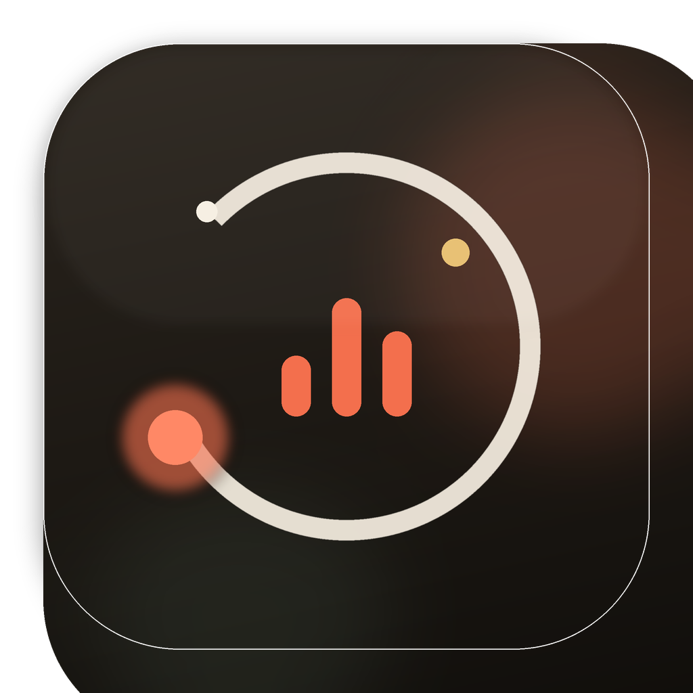
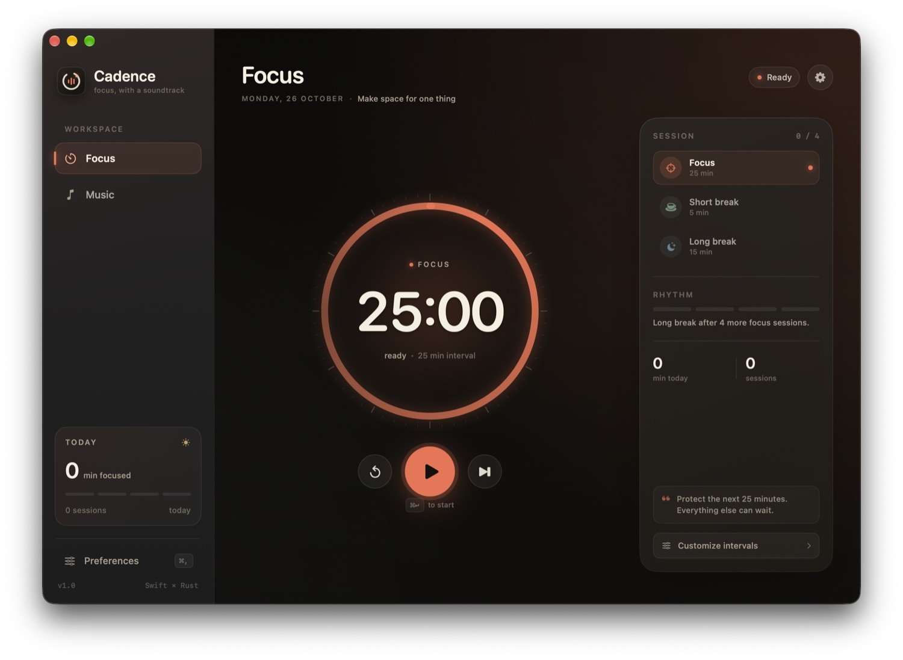
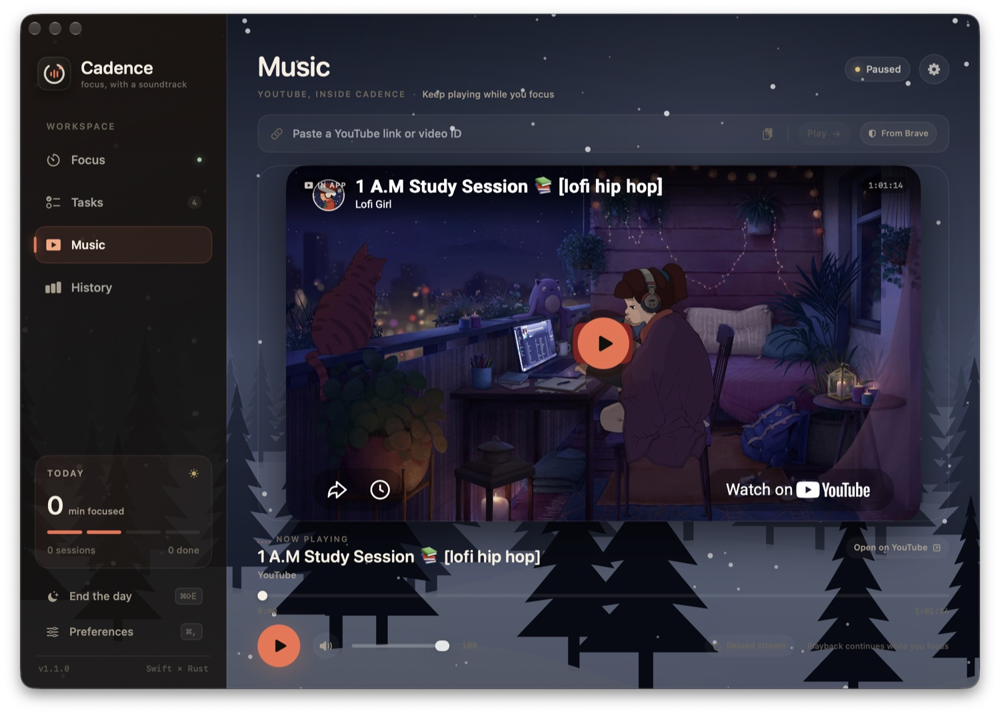
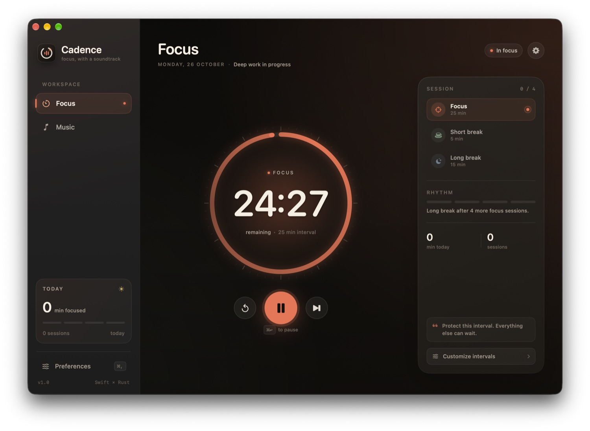
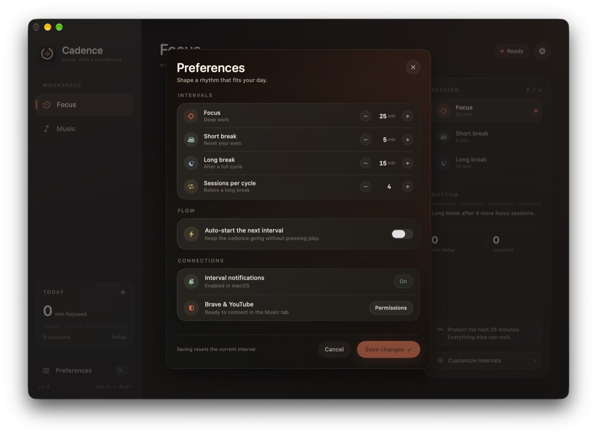

# Cadence

<p align="left"></p>

**A native macOS focus player.** A Pomodoro timer, an Eisenhower task board that plans your day into focus blocks, a focus history, and a built-in YouTube player that can pick up the video you were watching in Brave.

Cadence is deliberately split down the middle: the interface is SwiftUI, while the timer state machine, tasks, day planner and persistence are Rust. The app talks to the Rust core over a tiny JSON-over-C ABI.



## What's inside

- **Focus** — 25/5/15 Pomodoro intervals, a long break every four focus sessions, configurable durations, an intention check-in before each focus block, and today's stats. A running interval survives quitting and relaunching.
- **Tasks** — an urgent/important matrix with block estimates, and a day plan that time-boxes your open tasks into focus blocks and breaks toward a daily target.
- **History** — every completed focus block is logged with its task, quadrant and intention: last-14-days chart, weekly total, streak, best day, and a quadrant split.
- **Music** — an embedded YouTube player (paste a link, or pull the video playing in Brave and continue it in Cadence). Optionally pauses when focus stops and resumes when it starts.
- **Automation** — a focus guard that nudges you when a distracting app comes forward during focus, and Shortcuts that run when focus starts/stops (e.g. to toggle a macOS Focus mode).
- **Notifications** — the interval-end banner is scheduled with macOS when an interval starts, so it arrives on time even if the app is throttled or quit.
- **Menu bar widget** and an **end-of-day shutdown ritual**.
- **Keyboard-first** — start, pause, reset, skip, and switch tabs without leaving the keyboard.



## Install

Download `Cadence-<version>.zip` from the [latest release](https://github.com/aminefourari/cadence/releases/latest), unzip it, and move `Cadence.app` to `/Applications`.

The app is ad-hoc signed, not notarized, so the first launch is blocked by Gatekeeper. Open it once, then go to **System Settings → Privacy & Security** and choose **Open Anyway**. Alternatively, run `xattr -dr com.apple.quarantine /Applications/Cadence.app`.

### Updates

Cadence checks GitHub for a newer release once a day. When one exists, you'll see a notice. Install it from **Preferences → General → Updates** or **Cadence → Check for Updates…**. Cadence downloads the release, checks that it is a valid Cadence bundle of the expected version, replaces itself, and relaunches. The app needs write access to the folder it lives in (true for `/Applications` on most Macs).

After an update, macOS may ask again for permission to control Brave. This happens because each ad-hoc signed build is treated as a new app.

## Requirements

- macOS 14 or newer (Apple Silicon)
- Xcode 16 or newer with Swift 5.9+
- Rust (install from [rustup.rs](https://rustup.rs)) — Cargo must be available at `~/.cargo/bin` or on `PATH`
- Brave Browser, for the music tab
- [XcodeGen](https://github.com/yonaskolb/XcodeGen) — optional, because `Cadence.xcodeproj` is checked in

## Run it

```bash
make run
```

Or open `Cadence.xcodeproj` in Xcode and press **Run**. The Xcode pre-build phase compiles the Rust core automatically.

To build a standalone Release app:

```bash
make release
open dist/Cadence.app
```

## Music and Brave

Paste any YouTube link or video ID into the Music tab and it plays inside Cadence. No API key needed.

To continue a video you are already watching in Brave, press **From Brave** (Cadence also tries this automatically the first time you open Music). Cadence reads the active YouTube tab's video, time and volume, pauses it in Brave, and resumes it in the app.

One-time setup:

1. In Brave's menu bar, enable **View → Developer → Allow JavaScript from Apple Events**.
2. When macOS asks whether Cadence may control Brave Browser, choose **Allow**.
   If you miss the prompt, enable it later in **System Settings → Privacy & Security → Automation**.

If several YouTube tabs are open, Cadence uses the active tab in the front window, or the first YouTube tab it finds.

## A closer look

<p align="center">
  
  
</p>

## Keyboard shortcuts

| Shortcut | Action |
| --- | --- |
| `⌘ 1` | Focus tab |
| `⌘ 2` | Tasks tab |
| `⌘ 3` | Music tab |
| `⌘ 4` | History tab |
| `⌘ ↩` | Start / pause the timer |
| `⌘ R` | Reset the current interval |
| `⌘ →` | Skip to the next interval |
| `⌘ ⇧ E` | End the day |
| `⌘ ⇧ T` | Toggle theme |
| `⌘ ,` | Preferences |

## Architecture

```text
┌──────────────────────────────────────────────┐
│ SwiftUI                                      │
│                                              │
│  AppModel   Focus / Tasks / Music / History  │
│  YouTubePlayer (WKWebView)   BraveImporter   │
│                  │                           │
│           CoreClient (C ABI + JSON)          │
└──────────────────┼───────────────────────────┘
                   │ cadence_core_invoke()
┌──────────────────▼───────────────────────────┐
│ Rust core — libcadence_core.a                │
│                                              │
│  timer.rs      Pomodoro state machine        │
│  tasks.rs      tasks, quadrants, day planner │
│  storage.rs    JSON persistence              │
└──────────────────────────────────────────────┘
```

### The ABI

The entire native interface is three C functions in `App/Bridge/CadenceCore.h`:

```c
char *cadence_core_invoke(const char *request);
void  cadence_core_free(char *pointer);
uint32_t cadence_core_abi_version(void);
```

Requests and responses are JSON. Commands: `initialize`, `tick`, `timer.start`, `timer.resume`, `timer.pause`, `timer.toggle`, `timer.reset`, `timer.skip`, `timer.select`, `timer.configure`, `timer.assignTask`, `tasks.list`, `tasks.add`, `tasks.update`, `tasks.toggle`, `tasks.delete`, `tasks.clearOpen`, `sessions.list`, and `plan.build`.

The Rust core owns:

- the interval state machine and transitions, including restoring a running interval after relaunch
- auto-advancing after a completed interval and the long-break cycle
- tasks, the focus-session log, and the day planner
- daily/all-time stats and persistence (`~/Library/Application Support/Cadence/core-state.json`; an unreadable file is moved aside to `core-state.corrupt-<ms>.json`, never overwritten)

SwiftUI renders state, sends intents, and owns the YouTube player, Brave import, notifications and automation.

## Project layout

```text
App/
  Bridge/              C header + Swift bridging header
  Sources/             SwiftUI app, models, Rust client, views
  Resources/           asset catalog and app icon
  Info.plist
  Cadence.entitlements
core/
  src/lib.rs           C ABI + command routing
  src/timer.rs         Pomodoro engine and unit tests
  src/storage.rs       Persistence
  src/tasks.rs         Tasks, focus sessions, day planner
  Cargo.toml
scripts/
  generate_icon.py     Rebuilds the app icon asset catalog
docs/screenshots/      README screenshots
project.yml            XcodeGen project definition
Cadence.xcodeproj      Ready-to-open Xcode project
```

## Data

Tasks, focus sessions, stats, interval settings and the running interval live at:

```text
~/Library/Application Support/Cadence/core-state.json
```

A running interval is saved too: after a relaunch it continues where it was, or completes if it ended while Cadence was closed. Appearance and automation settings live in `UserDefaults`. Launch with `--demo-data` to use a separate `core-demo.json` instead.

## Releasing

```bash
scripts/release.sh 1.2.0
```

The script needs a clean working tree. It bumps the version in `project.yml`, runs the tests, commits, tags `v1.2.0`, and pushes. The tag starts the **Release** workflow, which:

1. checks that the tag matches the app version
2. runs the Rust tests
3. builds the app on a macOS runner
4. publishes the GitHub release with `Cadence-1.2.0.zip`

Installed copies pick the release up through the in-app updater. To rebuild an existing tag, run the workflow manually from the Actions tab.

## Continuous integration

Every push to `main` and every pull request runs **CI**: the Rust core tests on Linux, and a full Release build of the macOS app. The app is uploaded as a downloadable artifact for 7 days, and a single **Check** job reports the overall result.

## Tests

```bash
make test
```

This runs the Rust unit tests for the timer state machine, long-break cycle, pause semantics, skipped sessions, session restore, corrupt-file recovery, the day planner, the FFI command envelope, and the JSON contract the Swift models decode.

To rebuild the app icon (requires Python 3 + Pillow):

```bash
python3 scripts/generate_icon.py
```

## Notes and limitations

- **Not sandboxed.** Apple Events automation and direct browser control require the non-sandboxed build used here. The app is ad-hoc signed for local use, not notarized. If you distribute it, sign and notarize it with your own Developer ID.
- **YouTube-dependent.** The player drives YouTube's embed player API and the Brave import reads the watch page; if YouTube changes either, `App/Sources/YouTubePlayer.swift` and `App/Sources/BraveImporter.swift` are the places to update.
- **Brave's JavaScript toggle is required.** This is a Brave security setting and cannot be enabled by Cadence automatically.
- The app is built for Apple Silicon. Add an `x86_64` Rust target (and update `ARCHS`) if you need Intel support.

Built with SwiftUI and a Rust core.
